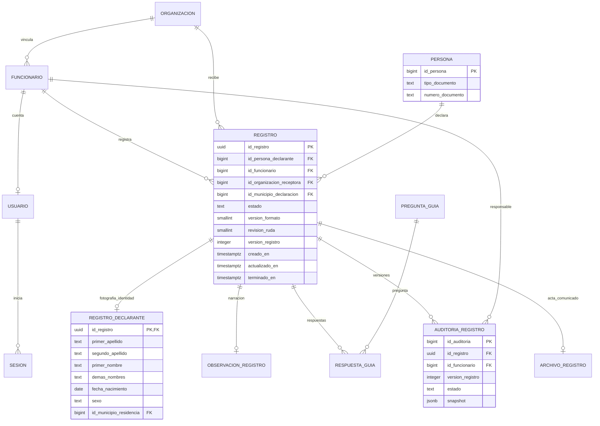
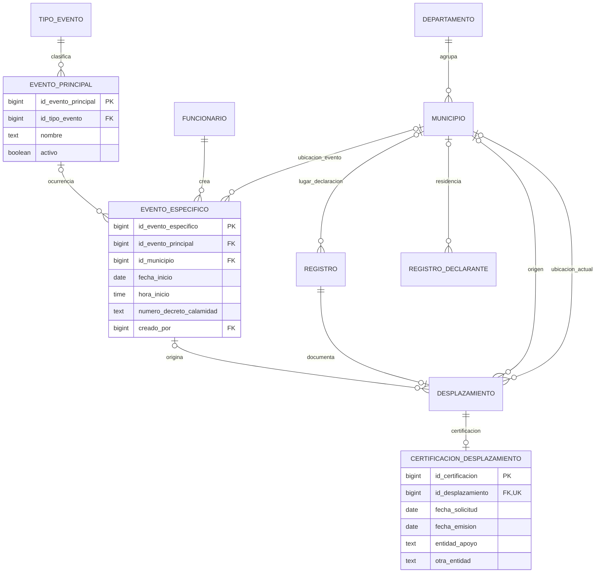
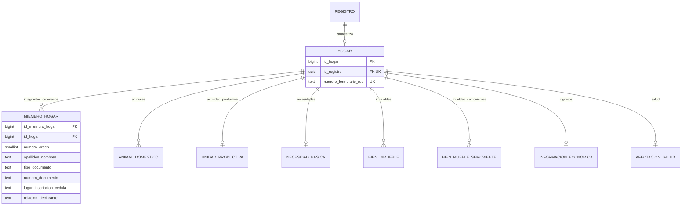
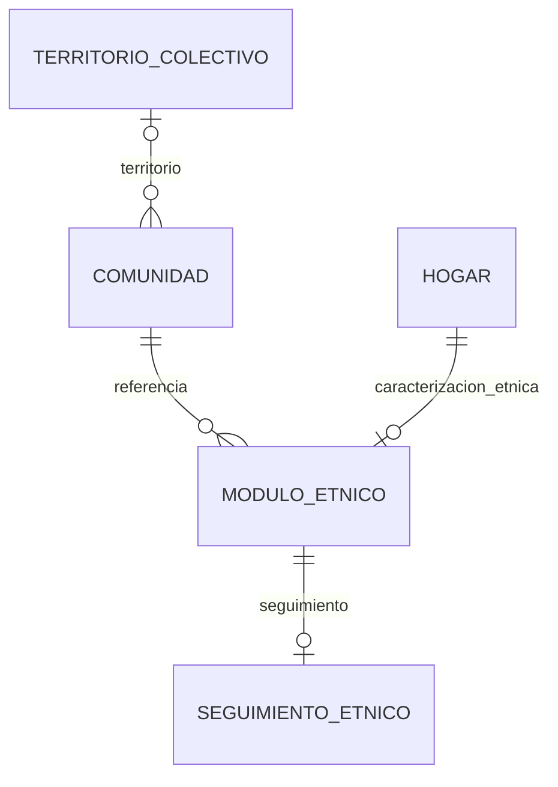

# Modelo entidad–relación

`||`: exactamente uno

`o|`: cero o uno

`o{`: cero o muchos

Las cardinalidades describen lo que permite la base, incluidos borradores. Para terminar, el contrato del formulario exige sus campos obligatorios y un hogar con integrantes.

## Registro, identidad y acceso

`PERSONA` guarda la identidad canónica por tipo y número de documento. Los nombres, domicilio y contacto capturados pertenecen a `REGISTRO_DECLARANTE`, por lo que un cambio en otro registro de la misma persona no reescribe su declaración histórica.

La auditoría conserva una captura completa por versión. La última captura permite reabrir exactamente lo escrito, incluidos datos todavía incompletos del borrador y la revisión de la ficha del declarante. Las tablas operativas mantienen la proyección normalizada dentro de la misma transacción.

## Eventos, desplazamiento y territorio

`TIPO_EVENTO` corresponde a la pregunta 29 y `EVENTO_PRINCIPAL` a la 30. `EVENTO_ESPECIFICO` identifica una ocurrencia compartida con fecha y ubicación. La certificación corresponde al desplazamiento, no a una decisión automática del programa.

## Hogar, patrimonio y afectaciones

Los integrantes se conservan como fueron declarados dentro de cada hogar; no comparten una ficha mutable con otros hogares. El orden es único dentro del hogar. La API evita documentos duplicados dentro de una misma captura.

La unidad productiva y las caracterizaciones de necesidades, economía y salud son únicas por hogar. Animales, inmuebles y muebles/semovientes permiten varios registros. El ingreso de la unidad productiva se expresa en SMMLV; el hogar registra ingreso en COP y equivalente en SMMLV en campos separados.

## Comunidad y seguimiento

El módulo se diligencia cuando corresponde a una comunidad étnica o a desplazamiento colectivo. Las respuestas incompletas de un borrador se conservan sin inventar nombres de comunidad, representante o territorio para satisfacer claves obligatorias.
