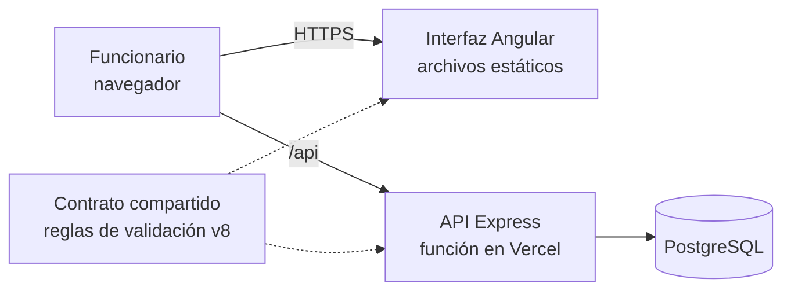

# Manual de sistema — RUDA v8

Fecha de actualización: 20 de octubre de 2026. Dirigido a desarrolladores y responsables de instalación, soporte y operación del sistema.

## 1. Propósito y alcance

RUDA es una aplicación web para que funcionarios de la UNGRD capturen declaraciones del Registro Único de Desplazamiento Ambiental, guarden avances, terminen registros, consulten eventos y vean estadísticas de sus propias capturas.

La fuente oficial del formulario es [RUDAM_F002_v8.xlsx](RUDAM_F002_v8.xlsx). La revisión del modelo es **8**; la portada del documento identifica el formato **F-RUDA-001, versión 5**. Estos valores no deben confundirse con `version_registro`, que aumenta con cada guardado para controlar la concurrencia.

Documentación relacionada:

- [Modelo físico oficial](modelo-ruda-v8.dbml).
- [Modelo entidad–relación](modelo-er.md).
- [Casos de uso](use-cases.md).
- [Manual de usuario](user-guide.md).
- [Informe de pruebas previas a Vercel](pruebas-previas-vercel.md).

**Lo que el sistema no hace.** Registra datos de certificación y seguimiento, pero no expide certificaciones, no aprueba la inclusión en el RUDA y no ejecuta trámites ante servicios externos. Tampoco tiene pantalla de administración de cuentas ni recuperación de contraseñas; la gestión de usuarios se hace por base de datos (sección 7).

**Estado actual.** El sistema está publicado en **https://ungrd-ruda.vercel.app** como entorno de demostración con información ficticia. Antes de usarlo con datos reales hay que atender las recomendaciones de la sección 12.

## 2. Arquitectura y componentes



El navegador carga la interfaz y envía las solicitudes de datos a `/api`. La API autentica, valida con las mismas reglas que usa la interfaz (el contrato compartido) y guarda en PostgreSQL.

| Componente | Implementación y responsabilidad |
| --- | --- |
| Interfaz | Angular 21, TypeScript y Tailwind CSS. Captura y consulta de información. |
| API | Express 5 sobre Node.js 24. Autenticación, autorización, validación y persistencia. |
| Base de datos | PostgreSQL; el entorno local usa PostgreSQL 17 en Docker. |
| Contrato compartido | Reglas utilizadas por el cliente y el servidor para validar RUDA v8. |
| Archivos | Acta o comunicado almacenado como contenido binario en la base de datos. |
| Despliegue | Frontend estático y función de API en Vercel; PostgreSQL externo (el diseño prevé Neon). |

En desarrollo, Angular recibe las solicitudes del navegador y redirige `/api` a Express mediante `proxy.conf.json`. En Vercel, las reescrituras de `vercel.json` dirigen `/api/*` al adaptador `api/index.mjs` y las rutas de la interfaz a `index.html`.

### Archivos principales

| Ruta desde la raíz | Uso |
| --- | --- |
| `src/app/form-schema.ts` | Preguntas, numeración y catálogos del formulario v8. |
| `src/app/form-contract.ts` | Reglas compartidas y validación de la captura. |
| `src/app/app.ts` | Navegación, edición, guardado y manejo de archivos en la interfaz. |
| `server/build-contract.cjs` | Genera el contrato ejecutable del servidor. |
| `server/generated/contract.mjs` | Archivo generado; no se edita manualmente. |
| `server/app.mjs` | Aplicación Express y rutas de API. |
| `server/index.mjs` | Inicio del servidor local. |
| `api/index.mjs` | Exportación de Express para Vercel. |
| `server/repository-v8.mjs` | Operaciones de persistencia del modelo activo. |
| `server/acta.mjs` | Validación y almacenamiento de actas. |
| `server/auth.mjs` | Contraseñas y tokens de sesión. |
| `server/db.mjs` | Conexión y transacciones de PostgreSQL. |
| `server/migrate.mjs` / `server/seed.mjs` | Migraciones y datos ficticios iniciales. |
| `compose.yaml` / `vercel.json` | Configuración local de PostgreSQL y configuración de despliegue. |

## 3. Requisitos e instalación local

Se necesitan:

- **Node.js 24** (el proyecto exige `24.x`).
- **npm 11** (el proyecto declara `npm@11.6.2`). Con npm 10, `npm ci` falla porque el archivo `package-lock.json` fue generado con npm 11. Comprobar la versión con `npm -v`.
- **Docker Desktop** en ejecución.
- Una terminal. Los comandos se ejecutan desde la raíz del proyecto.

Pasos:

1. Instalar dependencias con `npm ci`.
2. Si no existe `.env`, copiar `.env.example` como `.env`. Conservar la configuración existente si ya funciona.
3. En `.env`, reemplazar el valor de `PGPASSWORD` por una contraseña local.
4. Iniciar la base y preparar el esquema:

```powershell
npm run db:up
docker compose ps
npm run db:migrate
npm run db:seed
```

Esperar a que el servicio de base de datos esté saludable antes de migrar. El seed prepara la demostración; no es necesario ejecutarlo en cada arranque.

En una terminal, iniciar la API:

```powershell
npm run api
```

En otra terminal, iniciar la interfaz:

```powershell
npm start
```

| Servicio | Dirección local |
| --- | --- |
| Aplicación | `http://127.0.0.1:4305` |
| API | `http://127.0.0.1:4310/api` |
| Comprobación de conexión | `http://127.0.0.1:4310/api/health` |
| PostgreSQL | `127.0.0.1:54321` |

Usar la aplicación desde la dirección de Angular. La interfaz y la API se comunican mediante el proxy para mantener las cookies en el mismo origen.

### Variables de entorno

| Variable | Uso |
| --- | --- |
| `PGHOST` | Servidor de PostgreSQL local; ejemplo: `127.0.0.1`. |
| `PGPORT` | Puerto local; el Compose incluido publica `54321`. |
| `PGDATABASE` | Base de datos; ejemplo: `ruda`. |
| `PGUSER` | Usuario de conexión; ejemplo: `ruda`. |
| `PGPASSWORD` | Contraseña de la base. No publicar su valor. |
| `API_PORT` | Puerto del servidor local; predeterminado: `4310`. |
| `DATABASE_URL` | Cadena de conexión del backend desplegado. Tiene prioridad sobre `POSTGRES_URL`. |
| `POSTGRES_URL` | Alternativa de cadena de conexión si no existe `DATABASE_URL`. |
| `APP_ORIGIN` | Orígenes adicionales admitidos, separados por comas, con protocolo y sin rutas. |
| `NODE_ENV` | En producción activa cookies seguras. |
| `VERCEL`, `VERCEL_URL`, `VERCEL_BRANCH_URL` | Variables del entorno Vercel usadas para el proxy, cookies y orígenes admitidos. |

Si se define una URL de conexión, comprobar que apunta al entorno deseado antes de migrar o cargar ejemplos. El archivo `.env` pertenece al backend; sus valores no deben incorporarse al código del navegador ni a la documentación pública.

### Cuentas de demostración

El seed prepara `peter@example.com` y `gwen@example.com`, ambas con la contraseña de demostración `RudaDemo2026!`. Son cuentas para pruebas con datos ficticios. No usar estas credenciales para una operación con datos reales.

En una base nueva se generan ejemplos para los dos funcionarios. Si un funcionario ya tiene registros, el seed no reemplaza sus capturas con ejemplos nuevos.

## 4. Persistencia, migraciones y trazabilidad

El DBML v8 es la referencia física del modelo de negocio. Las tablas normalizadas representan declaraciones, hogares, integrantes, eventos, bienes, información económica, salud y módulo étnico. `auditoria_registro` conserva una captura de respuestas por versión, incluidos borradores incompletos. `archivo_registro` conserva el acta vigente.

El guardado de la captura, sus dependencias y su versión de auditoría ocurre en una transacción. El cliente envía la versión que conoce; una versión antigua produce un conflicto para evitar que una sesión sobrescriba cambios de otra.

Las migraciones **010** y **011** activan el modelo v8 y el almacenamiento de archivos. La transición conserva los datos anteriores en `ruda_legacy_v7`, mantiene los identificadores de registros y transforma la información histórica. Los registros terminados que no cumplen los requisitos nuevos vuelven a borrador para revisión; esto no equivale a perder el registro.

Las migraciones verifican su integridad. **No editar migraciones aplicadas ni sus auxiliares incluidos en las sumas de comprobación**; incorporar los cambios posteriores mediante nuevas migraciones. Antes de una actualización, respaldar la base y revisar el destino de conexión.

## 5. Reglas operativas relevantes

- Solo está habilitado el modo claro. Los modos oscuro y del sistema aparecen deshabilitados en el menú del usuario.
- Guardar un borrador requiere un documento válido; terminar exige los campos obligatorios aplicables y la revisión de los integrantes.
- Segundo apellido obligatorio; demás nombres opcional. La narración es obligatoria y no tiene longitud mínima; las preguntas guía son opcionales.
- El catálogo de eventos depende de su tipo. Mixto combina los eventos disponibles; Por determinar permite Otro.
- Las fechas de nacimiento deben ser reales y no futuras, dentro del rango admitido de 130 años. Los valores numéricos también se validan en el servidor.
- Los municipios deben corresponder con el departamento seleccionado.
- El módulo étnico-colectivo y otros detalles condicionales se validan cuando aplican.
- El porcentaje de respuestas incluye campos opcionales y no determina por sí solo si se puede terminar.
- Cada funcionario accede a sus registros, historial y archivos. La consulta de eventos se construye a partir de sus registros terminados.
- Los eventos pueden compartirse entre capturas; una edición no debe alterar la información de otras declaraciones asociadas.

### Acta o comunicado

Se admite un archivo vigente por registro, en formato PDF, PNG o JPEG, de hasta **4 MiB (4.194.304 bytes)**; la interfaz lo expresa como 4 MB. El servidor comprueba también el contenido del archivo. Una nueva carga reemplaza el archivo vigente; es posible descargarlo o retirarlo. El guardado ordinario del formulario conserva el adjunto.

El archivo se almacena en PostgreSQL, sin depender del disco temporal de la función desplegada. Las copias de seguridad de la base deben incluirlo. La auditoría de respuestas no debe interpretarse como un archivo histórico de todas las versiones del adjunto.

## 6. Autenticación y API

Las contraseñas se guardan con scrypt y sal propia. La sesión usa un token aleatorio cuyo hash se conserva en la base de datos. La cookie `ruda_session` dura ocho horas, tiene ruta `/api`, `HttpOnly` y `SameSite=Strict`; en producción se marca `Secure` y requiere HTTPS.

Las operaciones de escritura comprueban el origen cuando el navegador envía ese encabezado. Los orígenes de desarrollo están configurados en el servidor; los dominios adicionales se declaran en `APP_ORIGIN`.

El límite de intentos de acceso (10 por minuto y por dirección IP) se mantiene en memoria de cada instancia. No es un contador compartido entre las funciones de Vercel, por lo que no protege de forma fiable contra intentos repetidos.

| Método y ruta | Operación |
| --- | --- |
| `GET /api/health` | Comprobar la conexión a la base; acceso público. |
| `POST /api/auth/login` | Iniciar sesión con `email` y `password`; acceso público. |
| `GET /api/auth/me` | Obtener la cuenta autenticada. |
| `POST /api/auth/logout` | Cerrar la sesión actual. |
| `GET /api/forms` | Listar registros del funcionario. |
| `GET /api/events` | Consultar los eventos visibles para el funcionario. |
| `PUT /api/forms/:id` | Guardar una captura como borrador o actualizarla. |
| `POST /api/forms/:id/finish` | Validar y terminar una captura. |
| `GET /api/forms/:id/history` | Consultar las versiones del registro propio. |
| `PUT /api/forms/:id/acta?nombre=...` | Cargar el archivo con cuerpo binario `application/octet-stream`. |
| `GET /api/forms/:id/acta` | Descargar el archivo vigente. |
| `DELETE /api/forms/:id/acta` | Retirar el archivo vigente. |

Salvo las dos rutas indicadas como públicas, las rutas requieren una sesión válida. Los errores devuelven un mensaje y, cuando corresponde, una lista de problemas de validación. La interfaz no incorpora una pantalla de consulta del historial técnico.

## 7. Gestión de usuarios

La aplicación no tiene pantalla para administrar cuentas. Crear, desactivar o cambiar la contraseña de un usuario se hace con una consulta directa a la base de datos. Cada usuario pertenece a un funcionario, y cada funcionario a una organización.

Las consultas SQL se ejecutan así:

- **Base local:** `docker compose exec -T db psql -U ruda -d ruda -c "CONSULTA"`.
- **Base remota (por ejemplo, Neon):** `psql "CADENA_DE_CONEXION" -c "CONSULTA"`. Requiere las herramientas cliente de PostgreSQL instaladas.

Antes de modificar una base remota, comprobar a qué base apunta la conexión y hacer un respaldo.

### Generar el hash de una contraseña

La base no guarda la contraseña, sino su hash. Desde la raíz del proyecto:

```powershell
node -e "import('./server/auth.mjs').then(m=>console.log(m.hashPassword(process.argv[1])))" "ContraseñaNueva"
```

El resultado es una cadena larga con el formato `sal:clave`. Esa cadena es la que se usa en las consultas siguientes. La contraseña queda en el historial de la terminal; borrarlo si es una contraseña real.

### Crear un usuario

1. Consultar la organización: `SELECT id_organizacion, nombre FROM organizacion;`
2. Crear el funcionario. El documento debe ser único:

```sql
INSERT INTO funcionario (id_organizacion, nombre_completo, cargo, documento)
VALUES (1, 'Nombre Apellido', 'Funcionario', '1234567890')
RETURNING id_funcionario;
```

3. Crear el usuario con el `id_funcionario` obtenido. El correo debe estar en minúsculas:

```sql
INSERT INTO usuario (id_funcionario, correo, password_hash)
VALUES (3, 'nombre@correo.gov.co', 'HASH_GENERADO');
```

El rol predeterminado es `funcionario`. El rol `administrador` existe en la base, pero la aplicación todavía no le da funciones distintas.

### Cambiar la contraseña

```sql
UPDATE usuario SET password_hash = 'HASH_GENERADO' WHERE correo = 'nombre@correo.gov.co';
DELETE FROM sesion WHERE id_usuario = (SELECT id_usuario FROM usuario WHERE correo = 'nombre@correo.gov.co');
```

La segunda instrucción cierra las sesiones abiertas de esa cuenta.

### Desactivar un usuario

```sql
UPDATE usuario SET activo = false WHERE correo = 'nombre@correo.gov.co';
DELETE FROM sesion WHERE id_usuario = (SELECT id_usuario FROM usuario WHERE correo = 'nombre@correo.gov.co');
```

Un usuario desactivado no puede iniciar sesión. Sus registros se conservan.

## 8. Verificación antes de publicar

```powershell
npm test
npm run test:api
npm run test:predeploy
```

`npm test` verifica el contrato compartido y las estadísticas. `test:api` crea una base temporal local, ejecuta migraciones y seed dos veces, prueba los flujos del servidor y elimina la base temporal al finalizar. Requiere PostgreSQL local y permiso para crear bases; no se debe apuntar a una base remota para estas pruebas.

`test:predeploy` añade la compilación y las pruebas del adaptador en modo producción. La última ejecución documentada aprobó **33 pruebas sin fallos**. El [informe de pruebas](pruebas-previas-vercel.md) describe la cobertura automática, la revisión en navegador y los límites pendientes. Un resultado local correcto no acredita por sí solo el funcionamiento en la base remota o en la URL HTTPS final.

## 9. Despliegue en Vercel

El sistema está publicado en **https://ungrd-ruda.vercel.app**. La configuración del repositorio genera el contrato compartido y la aplicación con `npm run build:vercel`. La salida del frontend es `dist/ruda-web/browser`; la API se exporta desde `api/index.mjs` y la función tiene un máximo de 30 segundos de ejecución. El build **no ejecuta migraciones ni seed**.

### Procedimiento para un despliegue nuevo

1. Crear una base de PostgreSQL dedicada y obtener su conexión con pooling y TLS (el diseño prevé Neon).
2. Configurar `DATABASE_URL` como variable del backend en los entornos de Vercel que se vayan a usar. Mantener los secretos fuera del repositorio.
3. Si se usa un dominio personalizado, añadir su origen HTTPS exacto en `APP_ORIGIN`. Los dominios de despliegue y rama que entrega Vercel ya se contemplan en el código.
4. Desde un entorno controlado con la conexión de esa base, ejecutar `npm run db:migrate` y, si se quiere cargar la demostración, `npm run db:seed`. Revisar el destino antes de ejecutar ambos comandos.
5. Publicar con la configuración incluida y comprobar `/api/health` sobre HTTPS.
6. Probar inicio y cierre de sesión, aislamiento entre dos funcionarios, crear, guardar, reabrir y terminar un registro, estadísticas y carga y descarga de un acta.
7. Verificar que recargar una ruta interna conserva el acceso a la aplicación y que las cookies funcionan en el dominio final.

### Pendiente de documentar

Las pruebas del punto 6 sobre la URL publicada y sobre la base remota deben registrarse con fecha y responsable. Confirmar también con quien hizo el despliegue qué proveedor aloja la base de datos y qué variables están configuradas en Vercel. Este manual no presupone un plan comercial ni una cuota gratuita específica; revisar las condiciones de las cuentas antes de usar el sistema de forma permanente.

## 10. Operación y respaldo

Para detener el entorno local, finalizar los procesos de Angular y Express con `Ctrl+C` en sus terminales y detener PostgreSQL:

```powershell
docker compose stop db
```

Los datos permanecen en el volumen `ruda_pgdata`. Eliminar ese volumen elimina la base local; no usar esa operación como procedimiento de reinicio.

### Copia local de la base

Con los valores de ejemplo `PGUSER=ruda` y `PGDATABASE=ruda`, los siguientes comandos crean un respaldo con formato PostgreSQL y lo copian al equipo. Ajustar usuario y base si la instalación usa otros valores, y elegir un nombre distinto para cada respaldo.

```powershell
New-Item -ItemType Directory -Force backups
docker compose exec -T db pg_dump -U ruda -d ruda -Fc -f /tmp/ruda-backup.dump
docker compose cp db:/tmp/ruda-backup.dump ./backups/ruda-backup.dump
```

Comprobar que ambos comandos terminan correctamente y que el archivo fue copiado. No redirigir una copia binaria con `>` en PowerShell. Proteger los respaldos, ya que incluyen respuestas, archivos y datos de cuentas.

### Respaldo de una base remota

Con las herramientas cliente de PostgreSQL instaladas, usando la cadena de conexión de la base remota:

```powershell
pg_dump "CADENA_DE_CONEXION" -Fc -f ruda-remoto.dump
```

### Restaurar una copia

Restaurar siempre en una base separada y vacía, nunca encima de la base en uso. Ejemplo con la base local:

```powershell
docker compose cp ./backups/ruda-backup.dump db:/tmp/restore.dump
docker compose exec -T db createdb -U ruda ruda_restore
docker compose exec -T db pg_restore -U ruda -d ruda_restore --no-owner /tmp/restore.dump
docker compose exec -T db psql -U ruda -d ruda_restore -c "SELECT count(*) FROM registro;"
```

La última consulta cuenta los registros restaurados y sirve para comprobar que la copia tiene datos. Verificar periódicamente la restauración antes de confiar en la copia para recuperación. Para eliminar la base de prueba cuando ya no se necesite: `docker compose exec -T db dropdb -U ruda ruda_restore`.

### Actualizaciones y registros

Durante una actualización: respaldar, instalar las dependencias correspondientes, aplicar únicamente las migraciones nuevas, compilar, reiniciar la API y comprobar acceso y guardado. Recargar el navegador para usar el contrato v8 vigente.

Los errores locales aparecen en la terminal de la API; en Vercel deben revisarse los registros de ejecución de la función. Al reportar incidencias, registrar la hora, la operación, el código HTTP y el mensaje, evitando copiar contraseñas, cookies o cadenas de conexión.

## 11. Diagnóstico de incidencias

| Síntoma | Comprobación y acción |
| --- | --- |
| API sin conexión a la base | Revisar Docker, salud del servicio, puerto y variables; en remoto, revisar la URL y TLS. |
| Tablas inexistentes | Verificar la base seleccionada y ejecutar las migraciones pendientes. |
| `npm ci` falla | Comprobar que `npm -v` sea 11; con npm 10 el archivo `package-lock.json` no es compatible. |
| Contrato generado ausente | Ejecutar `npm run contract:build`; los comandos normales de API y migración ya lo incluyen. |
| Puerto ocupado | Identificar el servicio que ocupa 4305 o 4310; si cambia el puerto de API, ajustar también el proxy de desarrollo. |
| HTTP 401 | Credenciales incorrectas, sesión vencida, cookie ausente o usuario desactivado; volver a iniciar sesión. |
| HTTP 403 por origen | Revisar el dominio exacto y `APP_ORIGIN`; evitar orígenes con rutas o una barra final. |
| HTTP 409 | Conflicto de versión o cliente desactualizado; conservar los cambios relevantes y recargar el registro. |
| HTTP 413 | Archivo o solicitud demasiado grande; reducir el archivo a un máximo de 4 MiB. |
| HTTP 422 | Revisar los problemas devueltos: obligatoriedad, formatos, catálogos, municipios o valores únicos. |
| HTTP 429 | Esperar un minuto antes de volver a intentar el inicio de sesión. |
| HTTP 500 | Revisar los registros del servidor y la conexión; el mensaje al usuario no expone el error interno. |
| Registro terminado que aparece como por terminar | Comprobar si requiere completar requisitos v8 o si una edición dejó de cumplir las validaciones. |

Ante un fallo de migración, revisar primero el error y el destino de conexión. No borrar datos ni modificar sumas de comprobación para forzar su ejecución.

## 12. Limitaciones conocidas y recomendaciones antes de usar datos reales

El sistema maneja datos sensibles de población afectada (documentos de identidad, salud, discapacidad, pertenencia étnica y situación económica). En Colombia, el tratamiento de datos personales se rige por la Ley 1581 de 2012. Antes de cargar información real conviene revisar con el área jurídica y de seguridad de la entidad, entre otros, los puntos siguientes.

| Tema | Situación actual | Recomendación |
| --- | --- | --- |
| Credenciales de demostración | `peter@example.com` y `gwen@example.com` con una contraseña conocida, publicada en la documentación. | Desactivar o eliminar esas cuentas y crear las reales con la sección 7. |
| Botones de llenado | **Llenar parcialmente** y **Llenar por completo** están disponibles para cualquier usuario. | Retirarlos o limitarlos a entornos de prueba. |
| Intentos de inicio de sesión | El límite se guarda en memoria y no se comparte entre instancias. | Guardar los intentos en la base de datos o usar el límite de solicitudes de la plataforma. |
| Sesiones vencidas | La tabla `sesion` conserva las sesiones expiradas. | Borrar periódicamente las que tengan `expira_en` pasada. |
| Autoguardado y auditoría | Cada guardado escribe una versión completa en `auditoria_registro`, y el autoguardado se dispara tras una pausa breve al escribir. | Vigilar el tamaño de la tabla y considerar un intervalo mayor o guardar la versión de auditoría solo al terminar. |
| Asociación de eventos | Al asociar un registro a un evento existente, el servidor comprueba que el evento exista, pero no a quién pertenece. | Validar la propiedad o la organización del evento antes de permitir la asociación. |
| Cabeceras de seguridad | `vercel.json` no define cabeceras como `Content-Security-Policy`, `X-Frame-Options` o `Referrer-Policy`. | Añadirlas en la configuración de despliegue. |
| Dependencias | `esbuild` se usa en `server/build-contract.cjs`, pero no está declarado en `package.json`. | Declararlo en `devDependencies` y ejecutar `npm audit` periódicamente. |
| Respaldos | No hay un procedimiento automático. | Programar copias periódicas y probar la restauración (sección 10). |
