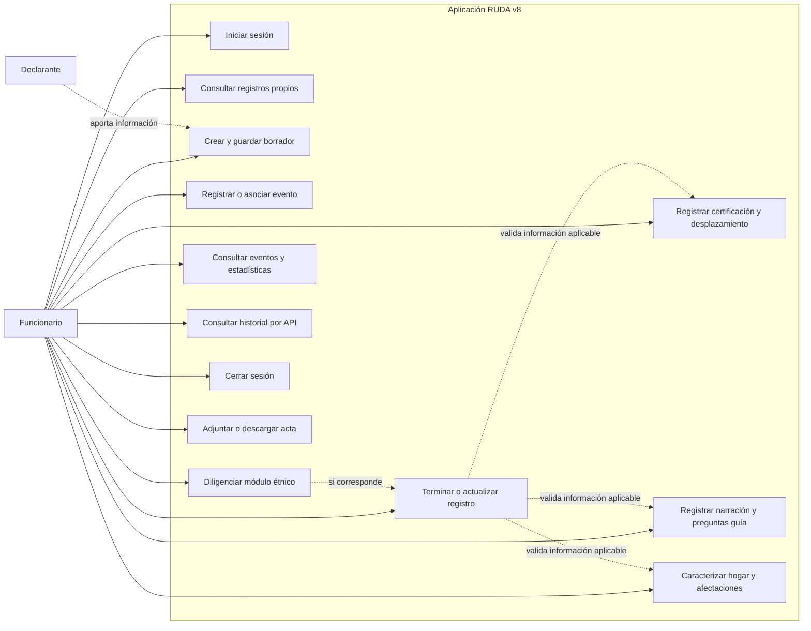

# Casos de uso

## Actores y alcance

### Funcionario
Actor autenticado que diligencia, consulta y actualiza sus registros.
### Declarante
Aporta la información durante la entrevista. No accede directamente al sistema.
### Organizaciones de apoyo y seguimiento
Se registran como datos del formulario; el programa no les envía solicitudes ni consulta sistemas externos.

El rol administrador está previsto en las cuentas, pero no existe una interfaz de administración de usuarios. Los casos de uso no atribuyen al sistema la expedición de certificaciones, la aprobación de inclusión en RUDA ni la atención humanitaria: el formulario captura información sobre esas actuaciones.

## Especificaciones

| ID | Caso | Precondición | Flujo principal | Resultado y alternativas |
| --- | --- | --- | --- | --- |
| CU-01 | Iniciar sesión | Cuenta activa | Ingresar correo y contraseña; la API verifica las credenciales y crea sesión | Acceso a registros propios. Credenciales incorrectas o sesión expirada impiden el acceso |
| CU-02 | Consultar registros propios | Sesión activa | Abrir Registros, filtrar y seleccionar uno | Se carga la última versión con su estado, captura y primera sección incompleta. No se accede a registros de otro funcionario |
| CU-03 | Crear y guardar borrador | Sesión activa | Crear registro; generar UUID; capturar tipo y número de documento válidos; completar información disponible; guardar manual o automáticamente | Se conserva el UUID y se registra una versión. Sin documento válido no se inserta. Un fallo mantiene los cambios abiertos y no confirma guardado |
| CU-04 | Registrar o asociar evento | Registro abierto | Seleccionar tipo y evento principal compatibles; registrar fecha y ubicación o asociar una ocurrencia disponible | El desplazamiento referencia un evento específico. Un evento compartido no se modifica al editar la captura de un solo registro |
| CU-05 | Registrar certificación y desplazamiento | Registro abierto | Capturar preguntas 35–38 y 39–52, incluyendo solicitud, emisión, entidad, salida, origen, ubicación actual y alojamiento | Se guardan certificación y desplazamiento. Para terminar se exigen los campos con asterisco. Las combinaciones departamento/municipio deben ser válidas |
| CU-06 | Registrar narración y guías | Registro abierto | Escribir la narración; responder opcionalmente las preguntas guía del evento seleccionado | Se conserva la observación y cada respuesta identificada por código. Narración vacía impide terminar; no hay mínimo de 300 caracteres |
| CU-07 | Caracterizar hogar y afectaciones | Registro abierto | Registrar formulario RUD si aplica; añadir y revisar integrantes; diligenciar animales, unidad productiva, necesidades, bienes, ingresos y salud | Cada integrante tiene orden dentro del hogar. No se repiten documentos. Los detalles de unidad productiva solo aplican si existe; los datos de atención dependen de la respuesta |
| CU-08 | Diligenciar módulo étnico-colectivo | Comunidad étnica o desplazamiento colectivo de al menos tres hogares de una misma comunidad | Indicar que aplica y capturar comunidad, territorio, representante, vínculo cultural, hogares y seguimiento | Se conservan módulo y seguimiento del hogar. Si no aplica, sus campos no bloquean el cierre ni cuentan en el progreso |
| CU-09 | Terminar o actualizar registro | Sesión activa y registro propio | Solicitar terminar; validar todas las obligaciones aplicables; confirmar registro, dependencias e historial en una transacción | Estado terminado y fecha de terminación. Si faltan datos, se indican los campos. Si otra sesión guardó, se rechaza por conflicto de versión. Editar y dejar incompleto un terminado lo devuelve a borrador |
| CU-10 | Consultar eventos y estadísticas | Sesión activa | Abrir Eventos o Estadísticas; revisar agrupaciones por evento, geografía y hogar | Información limitada a los registros del funcionario. Los indicadores de desplazamiento usan la fecha de salida v8, pregunta 39 |
| CU-11 | Consultar historial | Sesión activa y UUID de registro propio | Consultar `GET /api/forms/:id/history` | Lista versiones, estados y fechas. Disponible en API; no se presenta como una pantalla existente |
| CU-12 | Cerrar sesión | Sesión activa | Solicitar salir; resolver cambios pendientes y finalizar sesión | Se invalida la sesión. Un fallo de guardado pendiente puede impedir la salida hasta que el funcionario lo resuelva |
| CU-13 | Adjuntar, descargar o retirar acta | Registro propio guardado; para la carga desde el formulario, módulo étnico activo y pregunta 85 en Sí | Seleccionar PDF/PNG/JPG de hasta 4 MB; guardar el archivo; descargarlo o retirarlo cuando corresponda | El archivo persiste en la base y no desaparece al volver a guardar el formulario. Se rechazan archivos de tipo no admitido y acceso desde otro funcionario. Una carga posterior reemplaza el archivo actual |
